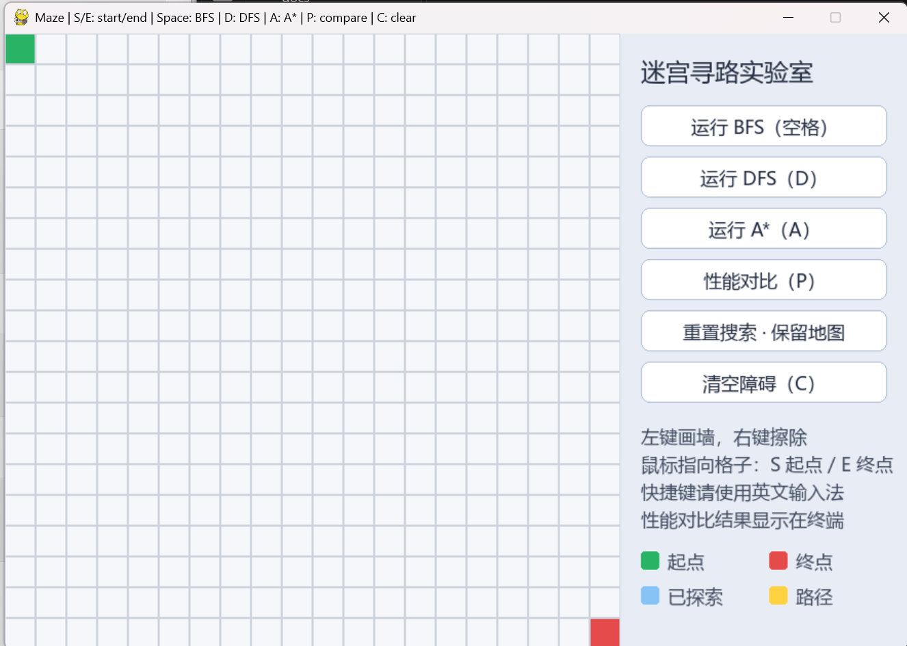

# 迷宫寻路算法可视化系统

基于 Python 和 Pygame 的互动迷宫系统，展示 BFS、DFS 和 A* 的搜索过程，并比较路径长度、探索节点数和算法耗时。

项目采用分阶段的 Vibe Coding 方式开发，通过人工交互验证和自动化测试检查功能。

## 界面预览



## 主要功能

- **迷宫编辑**：左键绘制障碍、右键擦除，自由设置起点和终点。
- **三种寻路算法**：BFS、DFS、A*。
- **搜索动画**：展示探索顺序与最终路径，支持暂停、继续和调速。
- **性能对比**：在窗口及终端显示路径步数、探索节点数、平均耗时。
- **地图保存与加载**：保存障碍和起终点，关闭后可以恢复。
- **预设地图**：空白、绕行、无解三种固定场景。
- **自动化测试**：当前34项测试通过。

## 环境与运行

当前验证环境为 Windows、Python 3.12.10、Pygame 2.6.1。

以下命令适用于 Windows PowerShell。

### 1. 下载项目

```powershell
git clone https://github.com/Wy-apex/maze-pathfinding.git
cd maze-pathfinding
```

### 2. 创建环境并安装依赖

请先安装 Python 3.12，然后执行：

```powershell
py -3.12 -m venv .venv312
.\.venv312\Scripts\python.exe -m pip install -r requirements.txt
```

### 3. 启动程序

```powershell
.\.venv312\Scripts\python.exe main.py
```

当前中文字体使用代码中指定的 Windows 字体文件。若启动时提示字体文件不存在，请将 `main.py` 中的 `font_path` 改为本机存在的中文字体路径，例如：

```python
font_path = r"C:\Windows\Fonts\msyh.ttc"
```

或：

```python
font_path = r"C:\Windows\Fonts\simsun.ttc"
```

## 操作说明

点击迷宫窗口使其获得键盘焦点。字母快捷键建议在英文输入法下使用。

| 操作 | 功能 |
|---|---|
| 鼠标左键按住拖动 | 绘制障碍 |
| 鼠标右键按住拖动 | 擦除障碍 |
| 鼠标指向格子，按 S | 设置起点 |
| 鼠标指向格子，按 E | 设置终点 |
| 空格 / BFS按钮 | 运行BFS |
| D / DFS按钮 | 运行DFS |
| A / A*按钮 | 运行A* |
| P / 性能对比按钮 | 比较三种算法 |
| F6 | 暂停或继续动画 |
| ↑ / ↓ | 加快或减慢动画 |
| 重置搜索按钮 | 清除搜索结果，保留地图和起终点 |
| C / 清空障碍按钮 | 清除障碍和搜索结果，保留起终点 |
| F5 / 保存地图按钮 | 保存当前地图 |
| F9 / 加载地图按钮 | 加载已保存地图 |
| F1 | 切换空白地图 |
| F2 | 切换绕行地图 |
| F3 | 切换无解地图 |

切换预设会替换当前地图，保留手绘地图前请先保存。

地图保存在 `maps/saved_maze.json`，每次保存覆盖上一份。保存内容包括障碍、起点和终点，不包括搜索颜色。

## 颜色含义

| 颜色 | 含义 |
|---|---|
| 绿色 | 起点 |
| 红色 | 终点 |
| 深色 | 障碍 |
| 白色 | 尚未显示为已探索的道路 |
| 蓝色 | 已播放的探索节点 |
| 黄色 | 最终路径 |

最终路径颜色覆盖探索颜色；起点和终点保留各自颜色。

## 算法说明

迷宫仅允许上下左右移动，每步代价为1。

| 算法 | 核心策略 | 是否保证最短路径 |
|---|---|---|
| BFS | 使用队列，按距离逐层探索 | 在当前移动规则下保证 |
| DFS | 使用栈，优先深入分支 | 不保证 |
| A* | 使用优先队列，根据 `f = g + h` 搜索 | 在当前实现和启发函数下保证 |

A*中的 `g` 为已知路径代价，`h` 为曼哈顿距离。总分相同时优先选择估计剩余距离较小的格子。

搜索动画采用探索顺序回放，不是算法实际计算速度。

## 性能对比方法

- 三种算法使用相同地图、起点、终点和移动规则。
- 探索节点数统计实际取出并处理的格子，包括起点和找到的终点。
- 路径步数为路径格子数减1，无解时单独显示。
- 每种算法预热后运行100次，计算平均耗时。
- 计时不包含动画、绘图和探索顺序记录。

探索节点较少不一定耗时更短。A*具有优先队列等额外开销，结果也受地图和运行环境影响，不能根据单次实验判断某种算法始终最快。

## 自动化测试

在项目根目录执行：

```powershell
.\.venv312\Scripts\python.exe -m pytest tests -v
```

当前验证结果为 **34 passed**，覆盖：

- 路径端点、边界、障碍和相邻步的合法性。
- 无解、起终点相同及禁止斜向移动。
- BFS和A*在指定案例中的最短路径。
- 算法不修改原地图。
- 地图保存与加载的一致性。
- 缺失、损坏及内容非法的地图文件。
- 预设地图的路径长度、无解结果和数据独立性。

文件读写测试使用临时目录，不覆盖实际保存的地图。界面按钮和动画交互目前采用人工验证。

## 项目结构

```text
maze-pathfinding/
├── main.py                  # 交互界面和动画
├── algorithms.py            # BFS、DFS、A*
├── benchmark.py             # 性能对比
├── map_storage.py           # 地图保存与加载
├── presets.py               # 预设地图
├── requirements.txt         # 依赖版本
├── maps/
│   └── saved_maze.json      # 保存的地图
├── tests/
│   ├── test_algorithms.py   # 算法测试
│   └── test_maps.py         # 地图与预设测试
└── docs/
    ├── experiment-log.md    # 实验记录
    ├── prompts.md           # 阶段需求记录
    └── screenshots/         # 实验截图
```

## 开发方式与局限

开发过程采用“描述需求 → AI协助生成代码 → 运行验证 → 反馈修正”的迭代方式。AI协助代码生成、算法解释和问题定位，开发者负责需求拆分、整合运行、交互验证与结果核对。

当前主要面向Windows，界面和网格尺寸固定，地图保存使用单一文件。性能测量是教学演示用途，测试未覆盖所有地图和界面交互。

后续可扩展多地图管理、随机迷宫、窗口自适应及更多测试场景。